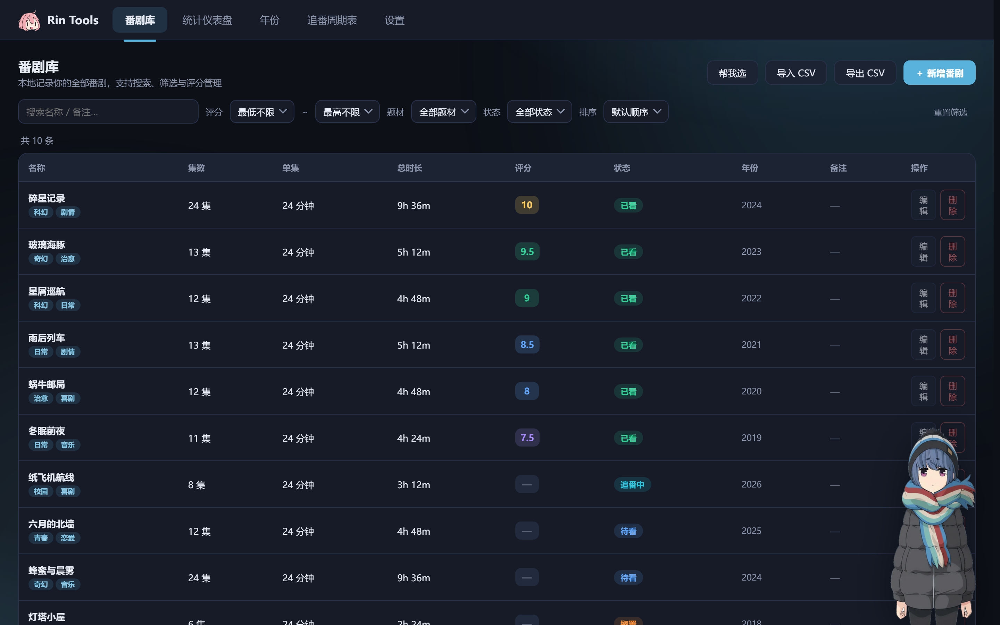
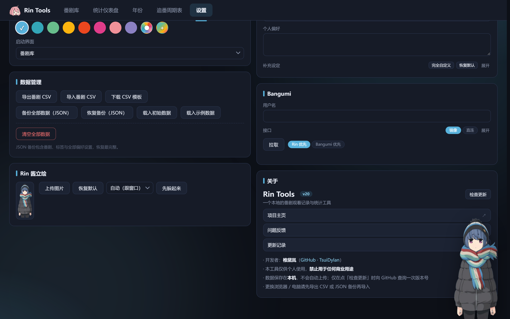

# Rin Tools

一个以单 HTML 文件为本体的番剧观看记录与统计工具。无框架、无构建步骤、无遥测；所有数据默认保存在本地。

| 番剧库 | 统计仪表盘 |
| --- | --- |
|  |  |

| 追番周期表 | 设置 |
| --- | --- |
|  |  |

> 截图中的条目为演示数据。

## 功能

- **番剧库**：条目式管理，支持名称搜索、评分区间、题材与状态筛选、多种排序；重名检测与右键快捷操作。
- **统计仪表盘**：总时长、平均分、标准差等汇总指标；评分分段统计与分布直方图；分段名称可点击自定义。
- **追番周期表**：按星期排布正在追的番剧，可直接在格内新建条目、拖拽调整。
- **年份统计**：按年份与季度回顾观看记录。
- **数据管理**：CSV 导入导出、JSON 完整备份恢复；桌面版支持 WebDAV 同步（坚果云等）。
- **主题**：深色 / 亮色 / 跟随系统，主题色可自选或自定义色值。
- **桌面端附加**：可接入自定义模型接口的本地聊天组件，立绘大小可按百分比调整。

## 下载

前往 [Releases](../../releases) 页面下载最新版本。两种载体共用同一份页面，功能一致，区别仅在运行环境与体积：

| 文件 | 载体 | 体积 | 适合 |
| --- | --- | --- | --- |
| `RinTools_v20.1.0_win-x64-light.zip` | Windows 桌面版 · 轻量壳 | 约 3 MB | **Windows 日常使用**，免安装 |
| `RinTools_v20.1.0_web.html` | 网页（单文件） | 约 1.4 MB | 双击用浏览器打开；部署为静态站点 |

## 快速开始

**网页版**：双击 HTML 文件（或部署到任意静态托管），浏览器打开即可使用。

**Windows 桌面版**：解压 zip，双击 `Rin Tools.exe`。免安装，可放在任意目录。

> 桌面版的数据分区与程序文件名绑定，请勿重命名 exe，否则已存数据将无法读取。

## 数据与隐私

- 分发版本**不含任何个人数据**，首次打开为空白库。
- 所有数据保存在本地（浏览器本地存储或桌面版程序存储区），不上传至任何服务器。
- 更换设备时，使用工具内的「备份全部数据（JSON）」导出，再在新设备导入即可；桌面版另支持 WebDAV 同步。
- 桌面版与网页版、以及两种桌面壳之间的本地存储相互独立。

## 更新日志

见 [Releases](../../releases)。

## 许可

自用工具，按原样提供（AS IS），仅供个人使用，禁止用于商业用途。
