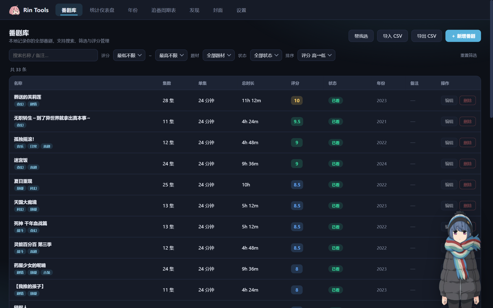
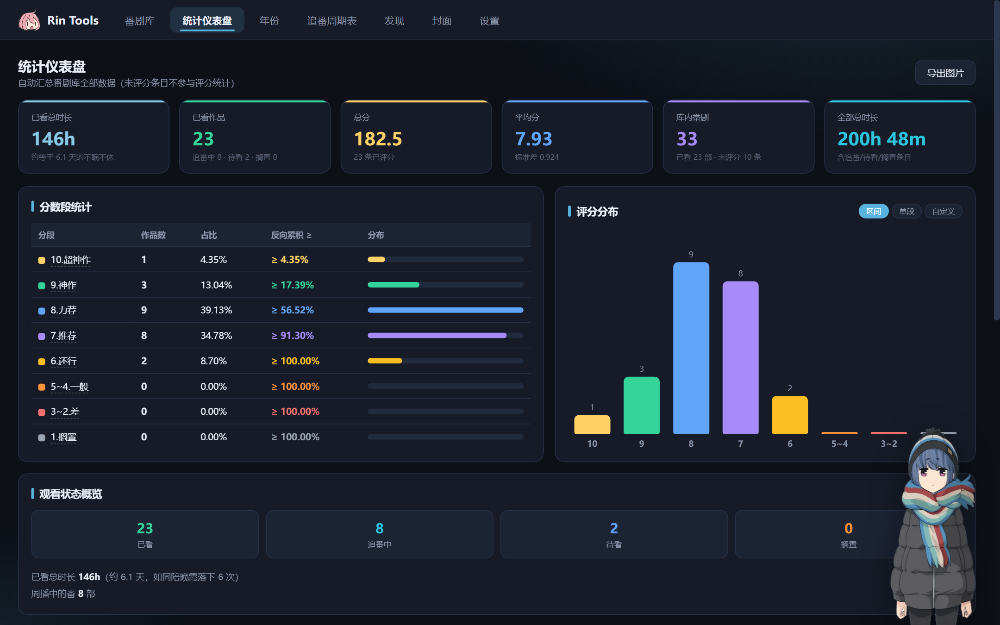
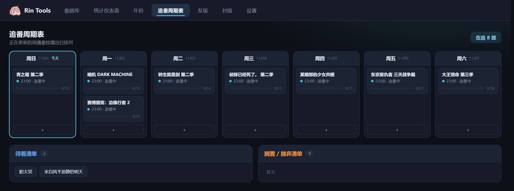
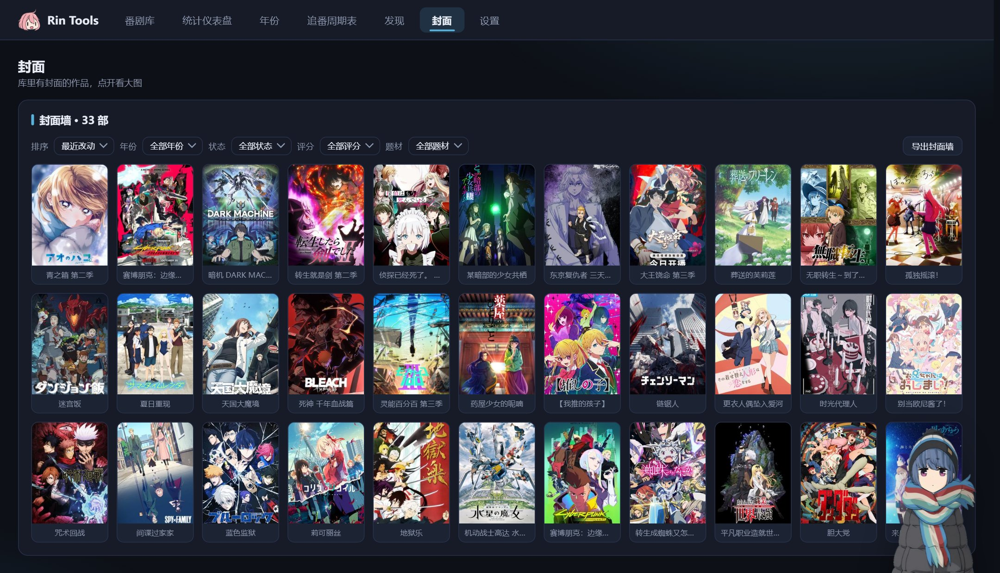
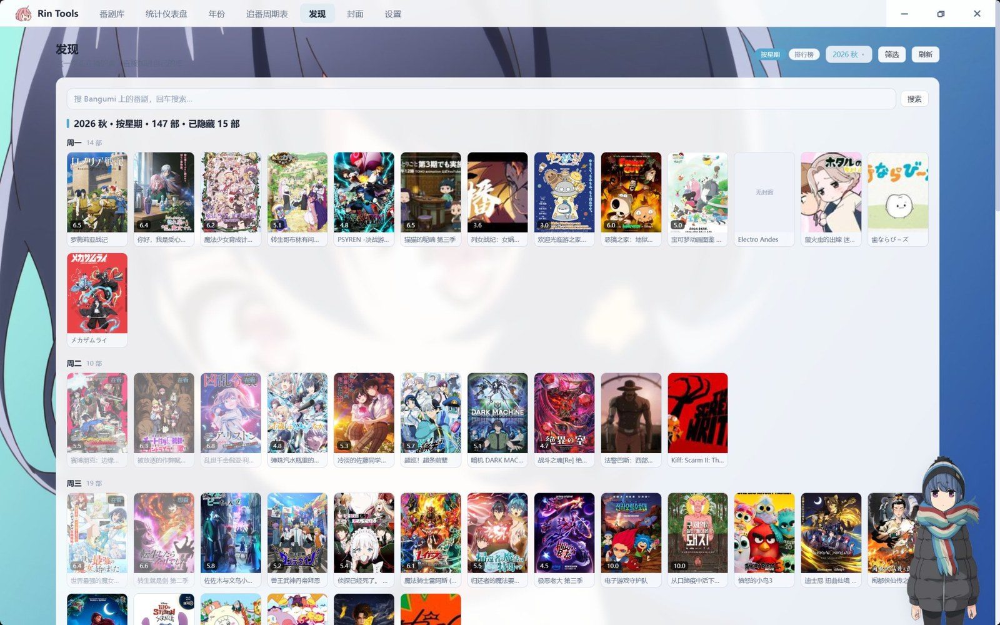
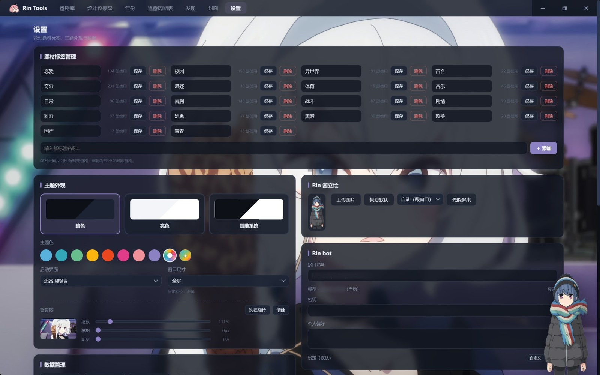

# Rin Tools

记录看过的动画，再把它折算成时间、评分与年份的统计。

**一个 HTML 文件就是全部。** 不安装、不注册、不联网也能开着用；所有记录只留在本机。

---

## 界面

| 番剧库 | 统计仪表盘 |
| :---: | :---: |
|  |  |

| 追番周期表 | 封面墙 |
| :---: | :---: |
|  |  |

| 发现页 | 设置 |
| :---: | :---: |
|  |  |

> 前四张的条目信息取自 Bangumi 公开资料（《葬送的芙莉莲》《孤独摇滚！》《迷宫饭》《夏日重现》等），评分、进度与备注为演示数据；后两张为实际界面。分发版本不含任何个人记录，首次打开是空库。

---

## 一条记录里有什么

名称、年份、集数、单集时长、评分、状态、题材标签、备注。

状态分四种：**已看 / 追番中 / 待看 / 搁置**。总时长由「集数 × 单集时长」自动算出，统计页的每一组数字都从这些字段来 —— 真正需要动手填的只有名称、集数与评分，其余都能算出来或事后补。

## 统计页能读到什么

- **已看总时长**，并折算成「不眠不休多少天」这类能感知的说法
- **评分分布**：直方图、标准差、按分数段统计的作品数与占比
- **年份视图**：按年与季度回顾当年看了什么
- **状态概览**：四类状态各多少部

## 除了记，还能看

- **追番周期表** —— 正在追的条目按放送日排进一周，格内可直接新建，也能拖拽调整
- **封面墙** —— 库内封面按最近改动排开，可按评分与题材筛选，支持手动挑选后单独导出
- **发现页** —— 按季度浏览新番，看中的直接加进库内；不相关的宣传映像与冷门条目可以筛掉
- **人物** —— 读取 Bangumi 收藏的角色与现实人物，排成头像墙，点开跳到对应页面（仅桌面版）
- **隐私** —— 受限条目可从番剧库与封面墙一并隐去；顶栏显示哪些页签、按什么顺序，可自行取舍
- **与 Bangumi 逐条同步** —— 改状态、点亮集数、加入收藏都会即时回写，不必攒着走整库同步；备注与短评互不覆盖，需要时在设置里单独开启
- **观看时间线** —— 按季度回看当年在追什么；一次性补录的条目会单独标出，不混进实际观看
- **导出** —— CSV 交换、JSON 完整备份与恢复、封面墙图片
- **设置** —— 题材标签可增删改并各自配色，主题色与背景图可调，立绘大小与启动页可选

## 两种载体

| 文件 | 载体 | 体积 | 说明 |
| :--- | :--- | :--- | :--- |
| `RinTools_v4.2.1_win-x64-light.zip` | Windows 桌面版（轻量壳） | 约 2.4 MB | 解压即用，免安装，可放在任意目录 |
| `RinTools_v4.2.1_web.html` | 网页（单文件） | 约 1.8 MB | 双击用浏览器打开，或部署为静态站点 |

两者是同一套页面，功能基本一致，差别在运行环境：桌面版能记忆窗口尺寸、接入本地模型接口，并读写 Bangumi 收藏的角色与人物。受浏览器跨域限制，「人物」与令牌配置只在桌面版可用。桌面版的数据分区与浏览器相互独立。

下载在 [Releases](../../releases)。

## 快速开始

**网页版**：双击 HTML 文件即可。也可以放到任意静态托管上，得到一个能跨设备打开的网址 —— 但记录仍只存在当前浏览器里。

**Windows 桌面版**：解压后双击目录里的 `Rin.exe`。

> 请从解压目录的 `Rin.exe` 启动，不要直接双击 `shell` 子目录里的程序 —— 那会绕开单实例检查与数据目录自检。

## 运行环境

**Windows 10（1809 及以上）或 Windows 11，64 位。**

- **不需要安装 .NET。** 启动器用的是 Windows 自带的 .NET Framework 4.8，系统没有额外要求。
- **需要 WebView2 运行时。** Windows 11 自带；Windows 10 装过 Chromium 版 Edge 的机器一般也有。如果程序打不开、或窗口打开后一片空白，多半是缺它 —— 到[微软官网](https://developer.microsoft.com/microsoft-edge/webview2/)装一次「Evergreen Bootstrapper」（约 2 MB）即可。
- 网页版只依赖浏览器，没有别的组件。

## 数据与隐私

- 分发版本**不含任何个人记录**，首次打开是空库。
- 记录保存在本地：网页版用浏览器的本地存储，桌面版用程序目录内的独立数据区。不上传、不联网同步到任何服务器。
- 换设备时，在工具内「备份全部数据」导出 JSON，到新设备导入即可；桌面版另支持 WebDAV 同步。
- 网页版、桌面版、以及不同桌面壳之间的本地存储相互独立，互不影响。
- 桌面版的数据区与程序文件名绑定，**不要重命名 exe**，否则已存记录读不出来。

## 与 Bangumi 的关系

条目信息可以手动填，也可以关联 Bangumi 自动补全年份、集数、封面与简介；收藏状态与评分可以双向核对。这部分需要联网，且为可选项 —— 不关联也能正常记录。

## 更新日志

见 [Releases](../../releases)。

## 许可

自用工具，按原样提供（AS IS），仅供个人使用，禁止用于商业目的。
